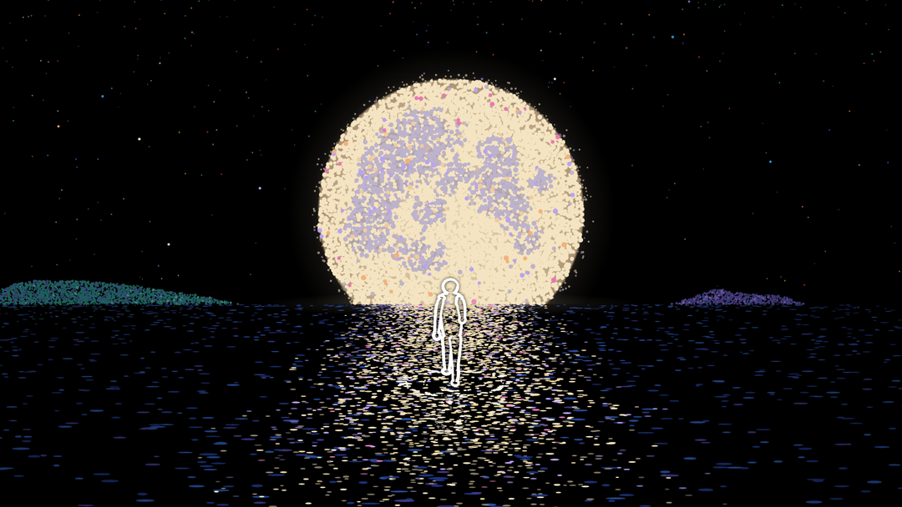

# stipple-night

A 12-second seamless loop, 1920x1080 at 24 fps: a figure walks along the moon's reflection
toward a large moon on the horizon, drawn entirely in stippled dots on black. Every frame is
rendered on a 2D canvas from its frame number alone, and the soundtrack is synthesized in Node
from the same event list, so picture and sound loop together exactly.



Every 12th drawing: [docs/contact-sheet.png](docs/contact-sheet.png).
One stride, drawings 0-17: [docs/walk-cycle.png](docs/walk-cycle.png).

## How it works

- `StippleNight.frame(i, ctx)` draws frame `i`. It reads no clock and calls no `Math.random`;
  all randomness is mulberry32 with fixed seeds. Any frame can be rendered alone, and the same
  browser build produces the same PNG bytes every time.
- The animation runs on twos: 288 frames show 144 drawings, and `frame(i + 288)` is
  byte-identical to `frame(i)`.
- Each surface (moon, islands, water) is a stipple field generated once on a jittered hex
  lattice. The hand-drawn boil cycles through three fixed variants of each dot instead of
  re-scattering, which keeps the H.264 bitrate down by roughly a factor of three.
- The water moves on a log-depth treadmill that repeats exactly once per loop. The figure walks
  in place, and its planted foot is fitted to the water speed at its depth, so it does not slide.
- Footsteps leave two expanding ripple rings drawn as a disturbance of the glitter: a dark trough
  of missing dots and a crest of brighter ones.
- `src/events.js` lists the 16 footsteps and 4 star chimes. The renderer uses it for ripples and
  star flares; `scripts/audio.cjs` uses it for water plips and chime notes.
- The soundtrack keeps every oscillator on a 1/12 Hz grid, so it repeats at exactly 576,000
  samples. Reverb is convolved over three loops and the middle loop is kept.
- Frames are captured as PNG from headless Edge or Chrome through puppeteer-core and encoded
  with ffmpeg: H.264 High, yuv420p, CRF 16, tagged BT.709.

The longer version, with the measurements behind each choice, is in
[docs/how-it-works.md](docs/how-it-works.md).

## Requirements

- Node 20 or newer.
- Microsoft Edge or Google Chrome. The scripts try the default install locations on Windows,
  macOS and Linux. Set `BROWSER_PATH` to the browser executable to use another one.
- ffmpeg and ffprobe built with libx264. If `tools/ffmpeg/bin` exists in the repo folder it is
  used; otherwise both are taken from `PATH`.

## Quickstart

```sh
npm install
npm run still      # one frame, phone preview and hero crop in output/stills
npm run render     # all 288 frames, loop checks, encodes and sheets in output/render
npm run audio      # soundtrack and audio report in output/audio
npm run mux        # 12 s and 36 s files with sound in output/final
```

`npm run mux` uses `output/render/night-loop-master-crf16.mp4` and `output/audio` by default,
so run it after `render` and `audio`.

## Scripts

| Script | File | What it writes |
|---|---|---|
| `npm run preview -- [layout] [boil] [frame...]` | `scripts/preview.cjs` | Quick PNGs in `output/preview`. Layout `night` or `test`, boil `coherent` or `scatter`. |
| `npm run still -- [frame] [outDir]` | `scripts/still.cjs` | Full frame, 1080-wide preview and a 560x315 crop. Renders twice in separate browser launches and fails if the PNGs differ. |
| `npm run render -- [outDir] [--tag=name] [--stride]` | `scripts/render-loop.cjs` | 288 PNG frames, `frame-hashes.json`, a CRF 16 master, a two-pass 5 Mbps copy, contact sheet, walk strip, ripple strip and phone previews. `--stride` renders drawings 0-17 and the strips only. |
| `npm run audio` | `scripts/audio.cjs` | `night-loop.wav`, `night-loop-x3.wav`, `audio-report.json`, `events-used.md`, spectrogram and waveform in `output/audio`. |
| `npm run mux -- [master.mp4] [--audio=dir] [--out=dir] [--tag=name]` | `scripts/mux.cjs` | `stipple-night-12s.mp4`, `stipple-night-x3.mp4` and `final-report.json`. |
| `npm run boil-test` | `scripts/boil-test.cjs` | A 48-frame comparison of coherent and re-scattered boil at three bitrates in `output/boil-test`. |

`scripts/browser.cjs`, `scripts/media.cjs` and `scripts/sheet.cjs` are shared helpers for
browser capture, ffmpeg calls and labelled image grids.

## Layout

```
index.html               canvas host page; loads src/ in dependency order
src/rng.js               mulberry32, seed mixing, modulo
src/events.js            timing constants, footsteps and chimes (browser and Node)
src/stipple.js           dot batching, stipple field generation, boil variants
src/water.js             water treadmill, glitter, ripples, island reflections
src/figure.js            walk cycle, outline drawing, water reflection
src/scene.js             layouts, stars, moon, islands, frame(i, ctx)
scripts/                 render, audio, encode and verification scripts
docs/                    design notes and images
```

Everything the scripts produce goes under `output/`, which is not tracked.

## Determinism and how to verify it

`npm run render` checks, and exits non-zero if any check fails:

- frame 288 is byte-identical to frame 0, and frame 287 is not;
- both frames of each of the 144 drawings are identical;
- the PNG files on disk match the hashes taken at render time;
- 24 sampled frames, rendered again in a second browser launch, match.

`npm run mux` checks that audio and video durations differ by less than one AAC frame, that
decoded frames 0, 288 and 576 of the 36 s file are identical and match frame 0 of the master,
and that the sample steps at the 12 s and 24 s joins are no larger than the 99.9th percentile of
steps elsewhere.

Expected values from the original render (Edge 156.0.4314.50, Node 24.22.1, Windows):

| Output | SHA-256 |
|---|---|
| frame 0 PNG | `3f989e4e33fe384c7a3c3c0b9513d285193094bb58ba453efe74dd7d3c0d74f0` |
| `night-loop.wav` | `56f1a1ba3cfd9229f232c73547467ca732269dbfd4e78e310a1afe51e3259ca7` |

```sh
node -e "const h=require('./output/render/frame-hashes.json').hashes; console.log(h[0], h[288] === h[0])"
node -e "console.log(require('./output/final/final-report.json').audioSha256)"
```

Measured on the original files (`final-report.json`): the 12 s file is 13.35 MB with video at
8571 kbps and AAC-LC audio at 324 kbps; both files measure -14.0 LUFS integrated with a true
peak of -3.6 dBTP.

## Notes and limits

- PNG hashes hold for the same browser build. A different Edge or Chrome version can shift
  antialiasing by one level on some pixels, which changes the hashes without a visible
  difference. The loop and on-twos checks still hold within one build.
- The audio is computed in Node and does not depend on the browser. It was verified with
  Node 24.22.1.
- Rendering, encoding and the hash values were verified on Windows with Edge. The macOS and
  Linux browser paths are tried but have not been tested.
- `render-loop.cjs` renders every frame on one page in sequence.
- With the same ffmpeg build, the CRF 16 master re-encodes byte for byte. The two-pass 5 Mbps
  copy does not: two runs from the same frames came out at 7,055,700 and 7,048,943 bytes.
- `npm run audio` overwrites `output/audio`, and `npm run boil-test` replaces
  `output/boil-test`.
- The delivery files are not committed. Run the quickstart to produce them.

## Credits

The dot style is inspired by the stippled animations of cemhah on X (https://x.com/cemhah).

## License

MIT. See [LICENSE](LICENSE).
